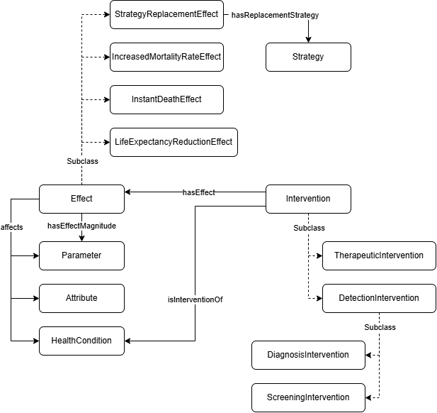

Within each model, you must define two or more **Interventions** ([`osdi:Intervention`]({{ config.extra.osdi }}#Intervention)) to be compared in the cost-effectiveness analysis. The model identifies the assessed intervention ([`osdi:hasAssessedIntervention`]({{ config.extra.osdi }}#hasAssessedIntervention)) and its comparators ([`osdi:hasComparatorIntervention`]({{ config.extra.osdi }}#hasComparatorIntervention)), as shown in the [decision model section](model_structure.md).



### 7.1. The target of an intervention

Every intervention has exactly one **target** ([`osdi:isInterventionOf`]({{ config.extra.osdi }}#isInterventionOf), or its inverse [`osdi:hasIntervention`]({{ config.extra.osdi }}#hasIntervention)): the health condition it is applied to, i.e., the disease or an element of its progression (a development, a stage or a manifestation).

- Time 0 is the moment when the intervention is applied: every patient presents the target, and the intervention is active during the whole simulation. Hence, a target should not have temporal constraints (such as an onset age).
- With an acute manifestation as the target, every patient starts with an episode (e.g., a migraine attack).
- The interventions compared in a model have the same target.
- The target of a detection intervention (screening or diagnosis) is the disease it detects, and the intervention applies to the population at risk of that disease, not only to those who present it.
- Since an intervention has exactly one target, it cannot be shared by the models of different diseases: a reasoner would infer that the diseases are the same individual. Give each model its own interventions.

**TTL Example (Interventions for comparing NBS versus clinical detection):**

```turtle
osdi:BD_InterventionNoScreening 
    a owl:NamedIndividual , osdi:DiagnosisIntervention ;
    osdi:hasDescription "No screening, i.e., clinical detection, of BD" ;
    osdi:isInterventionOf osdi:BD_Disease .

osdi:BD_InterventionScreening 
    a owl:NamedIndividual , osdi:ScreeningIntervention ;
    osdi:hasDescription "Basic screening intervention for BD" ;
    osdi:isInterventionOf osdi:BD_Disease ;
    osdi:hasEffect osdi:BD_InterventionScreeningStrategies , osdi:BD_InterventionScreeningEffect .
```

### 7.2. Strategies

**Strategies** ([`osdi:Strategy`]({{ config.extra.osdi }}#Strategy)) describe what is done to detect, treat or follow up a health condition: detection strategies ([`osdi:ScreeningStrategy`]({{ config.extra.osdi }}#ScreeningStrategy) and [`osdi:DiagnosisStrategy`]({{ config.extra.osdi }}#DiagnosisStrategy)), lines of therapy ([`osdi:LineOfTherapy`]({{ config.extra.osdi }}#LineOfTherapy)) and follow-up strategies ([`osdi:FollowUpStrategy`]({{ config.extra.osdi }}#FollowUpStrategy)). A strategy may have costs and utilities, use health technologies ([`osdi:usesHealthTechnology`]({{ config.extra.osdi }}#usesHealthTechnology)) and be followed by other strategies ([`osdi:followedByStrategy`]({{ config.extra.osdi }}#followedByStrategy)). Several strategies can be put together in a [`osdi:Group`]({{ config.extra.osdi }}#Group).

The **health conditions** declare the strategies that are applied to them ([`osdi:hasStrategy`]({{ config.extra.osdi }}#hasStrategy)). In the reference case, without screening, BD is detected by a clinical diagnosis. The properties of the detection, i.e., the disease it detects ([`osdi:detects`]({{ config.extra.osdi }}#detects)), its sensitivity ([`osdi:hasSensitivity`]({{ config.extra.osdi }}#hasSensitivity)) and specificity ([`osdi:hasSpecificity`]({{ config.extra.osdi }}#hasSpecificity)), belong to the detection strategy.

**TTL Example (Detection strategies of BD):**

```turtle
osdi:BD_Disease
    osdi:hasStrategy osdi:BD_ClinicalDiagnosis .

osdi:BD_ClinicalDiagnosis
    a owl:NamedIndividual , osdi:DiagnosisStrategy ;
    osdi:hasDescription "Diagnosis of BD: quantitative enzymatic determination of biotinidase activity in serum" ;
    osdi:detects osdi:BD_Disease ;
    osdi:hasCost osdi:BD_CostDiagnosis ;
    osdi:hasSensitivity osdi:BD_DiagnosisSensitivity ;
    osdi:hasSpecificity osdi:BD_DiagnosisSpecificity .

osdi:BD_ScreeningStrategy
    a owl:NamedIndividual , osdi:ScreeningStrategy ;
    osdi:hasDescription "Newborn screening test for BD" ;
    osdi:detects osdi:BD_Disease ;
    osdi:hasCost osdi:BD_Cost_ScreeningTest ;
    osdi:hasSensitivity osdi:BD_ScreeningSensitivity ;
    osdi:hasSpecificity osdi:BD_ScreeningSpecificity .
```

**Interventions do not declare strategies directly.** Instead, an intervention replaces the strategies of a health condition in its arm by means of a [`osdi:StrategyReplacementEffect`]({{ config.extra.osdi }}#StrategyReplacementEffect), which affects the health condition ([`osdi:affects`]({{ config.extra.osdi }}#affects)) and declares the new strategy or group of strategies ([`osdi:hasReplacementStrategy`]({{ config.extra.osdi }}#hasReplacementStrategy)). The replacement works by type of strategy (detection, follow-up or treatment): the new strategies replace those of the same type that the health condition declares, and the strategies of other types are kept. In the screening arm, the detection strategies of BD are the screening test and the confirmatory diagnosis; in the comparator arm, BD keeps its clinical diagnosis.

**TTL Example (Strategies of the screening arm):**

```turtle
osdi:BD_InterventionScreeningStrategies
    a owl:NamedIndividual , osdi:StrategyReplacementEffect ;
    osdi:hasDescription "In the screening arm, the detection strategies of BD are the screening test and the confirmatory diagnosis" ;
    osdi:affects osdi:BD_Disease ;
    osdi:hasReplacementStrategy osdi:BD_ScreeningArmStrategies .

osdi:BD_ScreeningArmStrategies
    a owl:NamedIndividual , osdi:Group ;
    osdi:hasDescription "Detection strategies of BD in the screening arm" ;
    osdi:hasGroupItem osdi:BD_ScreeningStrategy , osdi:BD_ClinicalDiagnosis .
```

Strategies may also describe their **outcomes** ([`osdi:hasStrategyOutcome`]({{ config.extra.osdi }}#hasStrategyOutcome)): mutually exclusive results, each one with its risk, the strategy that follows it, its payoffs and effects, and whether it resolves the health condition. Treatment outcomes ([`osdi:TreatmentOutcome`]({{ config.extra.osdi }}#TreatmentOutcome)) include the success and the failure of a strategy ([`osdi:SuccessOutcome`]({{ config.extra.osdi }}#SuccessOutcome), [`osdi:FailureOutcome`]({{ config.extra.osdi }}#FailureOutcome)); detection outcomes ([`osdi:DetectionOutcome`]({{ config.extra.osdi }}#DetectionOutcome)) are positive, negative or inconclusive. There are short forms for the most common cases: [`osdi:failsIf`]({{ config.extra.osdi }}#failsIf), [`osdi:followedOnSuccessBy`]({{ config.extra.osdi }}#followedOnSuccessBy) and [`osdi:followedOnFailureBy`]({{ config.extra.osdi }}#followedOnFailureBy) for treatments, and the sensitivity and specificity for detection strategies. Finally, a strategy may cause **adverse events** ([`osdi:hasAdverseEvent`]({{ config.extra.osdi }}#hasAdverseEvent), [`osdi:AdverseEvent`]({{ config.extra.osdi }}#AdverseEvent)), with a risk per application of the strategy. The [validation example of Evans et al. (1997)](https://github.com/ontologies-ULL/OSDi/tree/main/examples/evans1997-migraine) uses outcomes, groups of alternative strategies and relapses after the response.

### 7.3. Effects

**Interventions** may involve costs and disutilities, but they should have some kind of effect ([`osdi:hasEffect`]({{ config.extra.osdi }}#hasEffect)) on the progression of the disease or the use of resources. **Effects** ([`osdi:Effect`]({{ config.extra.osdi }}#Effect)) are defined by the [`osdi:Attribute`]({{ config.extra.osdi }}#Attribute) or [`osdi:Parameter`]({{ config.extra.osdi }}#Parameter) they affect ([`osdi:affects`]({{ config.extra.osdi }}#affects)), and a Parameter that characterizes the magnitude of the effect ([`osdi:hasEffectMagnitude`]({{ config.extra.osdi }}#hasEffectMagnitude)).

The data item type of the magnitude defines how a generic effect is applied: a factor or a ratio multiplies; a relative risk or a hazard ratio ([`osdi:DI_HazardRatio`]({{ config.extra.osdi }}#DI_HazardRatio)) on a probability multiplies the equivalent rate; an odds ratio ([`osdi:DI_OddsRatio`]({{ config.extra.osdi }}#DI_OddsRatio)) multiplies the odds; a mean difference is subtracted; and any other type is an absolute value that replaces the affected item (see [`osdi:hasEffectMagnitude`]({{ config.extra.osdi }}#hasEffectMagnitude) for the details).

For example, according to the reference case, the effect of the screening should be to prevent the appearance of the manifestations related to profound BD. You can also use relative risks or mean differences to model such effects. 

**TTL Example (Effect of the screening):**

```turtle
osdi:BD_InterventionScreeningEffect 
    a owl:NamedIndividual , osdi:Effect ;
    osdi:affects osdi:BD_Proportion_Seizures_PBD , ... ;
    osdi:hasDescription "Sets the probabilities of all the manifestations to 0" ;
    osdi:hasEffectMagnitude osdi:BD_InterventionScreeningEffectMagnitude .

osdi:BD_InterventionScreeningEffectMagnitude 
    a owl:NamedIndividual , osdi:DeterministicParameter ;
    osdi:hasDataItemType osdi:DI_Continuous_Variable ;
    osdi:hasExpectedValue "0.0"^^xsd:double .
```

Effects can be also triggered by health conditions ([`osdi:HealthCondition`]({{ config.extra.osdi }}#HealthCondition)), pathways ([`osdi:Pathway`]({{ config.extra.osdi }}#Pathway)), outcomes of strategies and even populations ([`osdi:Population`]({{ config.extra.osdi }}#Population)). Currently, **OSDi** includes a number of specific effects of particular interest, such as sudden death ([`osdi:InstantDeathEffect`]({{ config.extra.osdi }}#InstantDeathEffect)), whose magnitude is the probability of the death event; life expectancy reduction ([`osdi:LifeExpectancyReductionEffect`]({{ config.extra.osdi }}#LifeExpectancyReductionEffect)); increased mortality rate ([`osdi:IncreasedMortalityRateEffect`]({{ config.extra.osdi }}#IncreasedMortalityRateEffect)); and the replacement of strategies ([`osdi:StrategyReplacementEffect`]({{ config.extra.osdi }}#StrategyReplacementEffect)) shown above, which has no magnitude.
